# BiliSURE — Newborn Jaundice Monitoring & Phototherapy Network

[](backend/src/tests/runTests.ts)
[](mobile/src/services/__tests__/bhutani.service.test.ts)
[-FC3949?style=flat-square)](#)

BiliSURE is a production-ready, mobile-only newborn jaundice monitoring and phototherapy referral management network application. It connects multiple referring centres (PHCs, CHCs, maternity clinics) and receiving hospitals across a district through a centralized backend, empowering doctors, nurses, hospital administrators, and district administrators to manage the complete clinical lifecycle of neonatal hyperbilirubinemia.

The mobile interface is designed directly from the original BiliSURE physical demonstration video (`bilisure app.mp4`), preserving its exact visual hierarchy, vibrant violet branding (`#7D3BFF`), rounded card components, and rapid touch interactions.

---

## 1. Visual Identity & Design System

Sampled directly from the high-resolution frame extractions of the reference video:

- **Primary Brand Purple:** `#7D3BFF` with linear gradient to `#C440FF` (used for hero banners, statistical summary screens, and primary CTA buttons).
- **Secondary / Action Purple:** `#9333EA` (used for elevated center FAB, active navigation tabs, and graphical spline charts).
- **Backgrounds:** Clean `#FFFFFF` and subtle warm neutral `#F8FAFC` for high-contrast, glare-free data entry in clinical environments.
- **Status Green:** `#00A569` (soft tint `#F2FDEF`) for normal bilirubin readings, available phototherapy stations, and successful discharges.
- **Status Amber:** `#F59E0B` (soft tint `#FDF4E5`) for intermediate Bhutani risk zones, pending referrals, and station cleaning/sanitization.
- **Status Coral Red:** `#FC3949` (soft tint `#FFF1F2`) for high-risk hyperbilirubinemia, occupied stations, and urgent transfer alerts.
- **Typography:** Modern clean sans-serif with prominent, large numerical displays (28–44pt) for immediate reading clarity in neonatal wards.
- **Form Controls:** Touch-friendly `h-14` (56px) rounded buttons (`borderRadius: 16`), card-based inputs, and responsive dropdowns.

---

## 2. Five User Roles & Responsibilities

The application accommodates all 5 authorized roles within a unified, role-aware mobile application (no web dashboards or desktop sidebars):

```
┌────────────────────────────────────────────────────────────────────────┐
│                        BILISURE ROLE ECOSYSTEM                         │
├────────────────────┬────────────────────┬──────────────────────────────┤
│ Role               │ Primary Facility   │ Key Capabilities             │
├────────────────────┼────────────────────┼──────────────────────────────┤
│ 1. Referring       │ PHC / CHC / Clinic │ • Baby Registration & UHID   │
│    Doctor          │                    │ • TSB / TcB Bilirubin Entry  │
│                    │                    │ • Bhutani Nomogram Risk View │
│                    │                    │ • Live PT Station Directory  │
│                    │                    │ • Create & Track Referrals   │
├────────────────────┼────────────────────┼──────────────────────────────┤
│ 2. Hospital        │ District Hospital  │ • Incoming Referrals Inbox   │
│    Doctor          │                    │ • Review / Accept / Decline  │
│                    │                    │ • Inpatient Bilirubin Trends │
│                    │                    │ • Prescribe Phototherapy     │
│                    │                    │ • Discharge Approval & Notes │
├────────────────────┼────────────────────┼──────────────────────────────┤
│ 3. Hospital        │ NICU / SNCU Ward   │ • Confirm Baby Arrival       │
│    Nurse / Staff   │                    │ • Create Admission Episode   │
│                    │                    │ • Allocate PT Station        │
│                    │                    │ • Record Treatment Cycles    │
│                    │                    │ • Release & Sanitize Station │
├────────────────────┼────────────────────┼──────────────────────────────┤
│ 4. Hospital        │ Facility Ops       │ • Hospital Fleet Management  │
│    Admin           │                    │ • Add / Edit PT Stations     │
│                    │                    │ • Toggle Maintenance / Ops   │
│                    │                    │ • Real-time Capacity Monitor │
├────────────────────┼────────────────────┼──────────────────────────────┤
│ 5. District        │ District Health    │ • District Facility Overview │
│    Admin           │ Directorate        │ • Total Infant Analytics     │
│                    │                    │ • Cross-Facility PT Balance  │
│                    │                    │ • De-identified Risk Grid    │
└────────────────────┴────────────────────┴──────────────────────────────┘
```

A quick **Role Switcher Bar** is positioned at the top of the mobile screen for evaluation, simulation, and multi-credentialed providers.

---

## 3. The 26-Step Connected Clinical Workflow

BiliSURE connects every link in the neonatal jaundice care chain without data siloing:

```mermaid
flowchart TD
    Step1[1. Referring Doctor Logs In] --> Step2[2. Register Newborn]
    Step2 --> Step3[3. Generate Permanent UHID]
    Step3 --> Step4[4. Enter Bilirubin Value TSB/TcB]
    Step4 --> Step5[5. Bhutani Nomogram Stratification]
    Step5 --> Step6[6. Clinical Assessment Recorded]
    Step6 --> Step7[7. Referral Decision Triggered]
    Step7 --> Step8[8. Query District Hospital Directory]
    Step8 --> Step9[9. View Live PT Station Availability]
    Step9 --> Step10[10. Select Hospital Manually]
    Step10 --> Step11[11. Dispatch Referral Request]
    Step11 --> Step12[12. Hospital Receives Real-time Alert]
    Step12 --> Step13[13. Hospital Doctor Reviews Case]
    Step13 --> Step14[14. Accept / Decline Decision]
    Step14 --> Step15[15. Referring Doctor Notified]
    Step15 --> Step16[16. Baby Physically Arrives]
    Step16 --> Step17[17. Hospital Nurse Confirms Arrival]
    Step17 --> Step18[18. Admission Episode Created]
    Step18 --> Step19[19. Allocate Vacant PT Station]
    Step19 --> Step20[20. Phototherapy Session Starts]
    Step20 --> Step21[21. Periodic Readings & Observations]
    Step21 --> Step22[22. Conclude Treatment Cycle]
    Step22 --> Step23[23. Doctor Approves Discharge]
    Step23 --> Step24[24. Record Follow-up Instructions]
    Step24 --> Step25[25. Station Released to Cleaning/Prep]
    Step25 --> Step26[26. Sanitize & Return to Available Pool]
```



---

## 4. Bhutani Hour-Specific Bilirubin Nomogram

The clinical decision support engine embeds the landmark **Bhutani et al. (1999) Hour-Specific Bilirubin Nomogram** (predischarge risk assessment for term and near-term newborns $\ge 35$ weeks gestational age):

- **Mathematical Engine (`bhutani.engine.ts` / `bhutani.service.ts`):**
  - Hour calculation from exact Date of Birth + Birth Time to Sample Collection Time (0–168 hours).
  - Multi-unit conversion between $\text{mg/dL}$ and $\mu\text{mol/L}$ ($1\text{ mg/dL} = 17.1\ \mu\text{mol/L}$).
  - Piecewise linear interpolation between standard percentiles:
    - **Low Risk:** $< 40\text{th}$ percentile ($< 8.5\text{ mg/dL}$ at 48h)
    - **Low-Intermediate Risk:** $40\text{th} - 75\text{th}$ percentile ($8.5 - 11.0\text{ mg/dL}$ at 48h)
    - **High-Intermediate Risk:** $75\text{th} - 95\text{th}$ percentile ($11.0 - 13.5\text{ mg/dL}$ at 48h)
    - **High Risk:** $\ge 95\text{th}$ percentile ($> 13.5\text{ mg/dL}$ at 48h)
- **Preterm Neonatal Safety:**
  - If Gestational Age $< 35$ weeks, the nomogram triggers a prominent cautionary banner: *"Preterm infant (<35 weeks). Bhutani nomogram is validated strictly for $\ge 35$ weeks. Consult gestational-age-specific neurotoxicity curves."*
- **Interactive SVG Chart Component (`BhutaniNomogramChart.tsx`):**
  - Native SVG rendering using `react-native-svg` (no WebView or heavy chart library overhead).
  - Shaded risk bands with soft pastel fills.
  - Plotted curves for the 40th, 75th, and 95th percentiles.
  - Interactive touch points displaying age, value, and phototherapy phase (Pre-PT, During PT, Post-PT).

---

## 5. Dynamic Hospital Capacity Engine

Hospital phototherapy capacity is calculated automatically in real time:

$$\text{Available Stations} = \text{Operational Stations} - \text{Occupied Stations}$$

Where:
- $\text{Operational Stations} = \text{Total Stations} - (\text{Maintenance} + \text{Out of Service})$.
- Double-allocation is strictly prevented by database-level and state guardrails.
- Referral acceptance and physical station allocation are decoupled events.
- On discharge, the station automatically transitions to `cleaning_prep` and requires manual nurse sign-off before returning to the `available` pool.

---

## 6. Directory Structure

```
BiliSURE_App/
├── backend/
│   ├── src/
│   │   ├── common/             # AppError, ApiResponse, Logger, Middlewares
│   │   ├── config/             # Database (MongoDB + in-memory fallback), Env
│   │   ├── models/             # Mongoose schemas: Hospital, PTStation, Referral,
│   │   │                       # Admission, Baby, BilirubinReading, Notification
│   │   ├── modules/
│   │   │   ├── admissions/     # Admission creation, treatment sessions, discharge
│   │   │   ├── auth/           # Role-based JWT authentication & credentials
│   │   │   ├── babies/         # Patient registration and demographic lookups
│   │   │   ├── bilirubin/      # Bilirubin entry with automatic Bhutani scoring
│   │   │   ├── clinical/       # Bhutani hour-specific nomogram calculation engine
│   │   │   ├── district/       # District-wide facility rollups & analytics
│   │   │   ├── hospitals/      # Hospital directory & live PT station capacity
│   │   │   ├── notifications/  # Role-targeted alerts & messaging
│   │   │   └── referrals/      # Inter-facility referral request/response pipeline
│   │   ├── routes/             # Unified Express router (/api/v1)
│   │   └── tests/
│   │       └── runTests.ts     # 14-phase, 26-step automated integration test suite
│   ├── dist/                   # Compiled TypeScript server
│   └── package.json
│
├── mobile/
│   ├── src/
│   │   ├── components/         # BhutaniNomogramChart, RoleSwitcherBar, TopBar
│   │   ├── features/
│   │   │   ├── analytics/      # Donut SummaryTotalScreen, StoriesCarouselScreen
│   │   │   ├── authentication/ # SplashScreen, OnboardingScreen, LoginScreen
│   │   │   ├── babies/         # NewRegistrationScreen, RegistrationSuccessScreen
│   │   │   ├── bilirubin/      # PresentBilirubinScreen (with embedded nomogram)
│   │   │   ├── dashboard/      # Role-adaptive DashboardScreen
│   │   │   ├── devices/        # CalibrationScreen, CalibrationStatus, DeviceAlert
│   │   │   ├── districtAdmin/  # DistrictOverviewScreen (cross-district metrics)
│   │   │   ├── hospitalAdmin/  # AdminStationsManagementScreen (fleet manager)
│   │   │   ├── hospitalDoctor/ # HospitalReferralsInboxScreen, DischargeApproval
│   │   │   ├── hospitalNurse/  # NurseArrivals, NurseStationAllocation,
│   │   │   │                   # NurseTreatmentTracker, StationReadinessScreen
│   │   │   ├── observations/   # ObservationsListScreen
│   │   │   ├── profile/        # ProfileScreen & user role badge
│   │   │   ├── recommendations/# RiskScreen, RecommendationsScreen
│   │   │   ├── referrals/      # HospitalDirectory, CreateReferral, ReferralTracker
│   │   │   ├── reports/        # ExportDataScreen
│   │   │   └── trends/         # PatientTrendsScreen (Bhutani risk & SVG curves)
│   │   ├── navigation/         # RootNavigator, BottomTabNavigator (dynamic tabs)
│   │   ├── services/           # bhutani.service.ts, api.ts, storage.ts
│   │   │   └── __tests__/      # bhutani.service.test.ts (Jest unit tests)
│   │   ├── store/              # useAuthStore, useNetworkStore, usePatientStore
│   │   ├── theme/              # colors.ts (exact sampled video palette)
│   │   └── types/              # Full TypeScript contracts for network & clinical models
│   ├── app.json                # Expo configuration
│   └── package.json
│
├── docs/                       # Architecture, Database, Sync, Video Analysis specs
└── README.md                   # System master manual
```

---

## 7. Verification & Testing

### Backend 14-Phase Integration Suite
To verify the complete 26-step backend workflow across all modules:

```bash
cd backend
npm test
```

**Verification Output:**
```text
=== STARTING COMPLETE BILISURE END-TO-END VERIFICATION SUITE ===
[Phase 1] System Health & Readiness: PASS (200 OK)
[Phase 2] Authentication & Multi-Role Access: PASS (JWT Token generated)
[Phase 3] Bhutani Hour-Specific Bilirubin Nomogram: PASS (42.5h, 4 risk zones, <35w alert)
[Phase 4] Newborn Patient Registration (Step 2): PASS (UHID generated)
[Phase 5] Record Bilirubin Reading (Steps 3-5): PASS (High risk zone identified)
[Phase 6] Hospital Directory & Live PT Capacity (Steps 8-9): PASS (Dynamic capacity calculated)
[Phase 7] Referring Doctor Creates Referral (Steps 10-12): PASS (REF ID created)
[Phase 8] Hospital Doctor Reviews & Accepts (Steps 13-15): PASS (Notification sent)
[Phase 9] Physical Arrival & Admission (Steps 16-18): PASS (Admission created)
[Phase 10] PT Station Allocation & Anti-Double Booking (Step 19): PASS (Blocked duplicate)
[Phase 11] Start & Conclude Phototherapy Cycles (Steps 20-22): PASS (Duration calculated)
[Phase 12] Discharge Approval & Station Sanitization (Steps 23-25): PASS (Released to pool)
[Phase 13] In-App Notifications Verification (Module M): PASS (9 alerts delivered)
[Phase 14] District Admin Analytics (Module O): PASS (District rollups & risk distribution)
>>> ALL 14 PHASES & 26-STEP WORKFLOW TESTS PASSED 100%! <<<
```

### Mobile Unit Test Suite
To verify the mathematical nomogram calculations and risk stratification:

```bash
cd mobile
npm test
```

**Verification Output:**
```text
PASS  src/services/__tests__/bhutani.service.test.ts
  Bhutani Bilirubin Risk Nomogram Service
    Postnatal Age Calculations
      √ calculates exact age in hours using birth date and time
      √ returns 0 for negative time differences
    Unit Conversions
      √ converts mg/dL to µmol/L correctly (1 mg/dL = 17.1 µmol/L)
      √ converts µmol/L to mg/dL correctly
    Nomogram Percentile Interpolation
      √ returns exact values at known hour anchors
      √ interpolates intermediate hours accurately
    Clinical Risk-Zone Classification
      √ classifies result below 40th percentile as Low Risk
      √ classifies result between 40th and 75th percentile as Low-Intermediate Risk
      √ classifies result between 75th and 95th percentile as High-Intermediate Risk
      √ classifies result above 95th percentile as High Risk
      √ flags preterm neonates (<35 weeks) as ineligible with clinical warning
      √ includes TcB screening note when measurement method is transcutaneous

Test Suites: 1 passed, 1 total
Tests:       12 passed, 12 total
```

### Type Safety
```bash
cd mobile && npm run typecheck
cd ../backend && npm run build
```
Both exit with code 0 and zero compilation errors.

---

## 8. Running the Application

### 1. Launch the Backend Server
```bash
cd backend
npm run dev
# Running on http://localhost:5000/api/v1
```

### 2. Launch the Mobile Application (Expo Dev Client)
```bash
cd mobile
npm start
# Press 'a' for Android emulator or scan QR code with Expo Go / Dev Client
```

Use the **Role Switcher Bar** at the top of the mobile screen to switch instantly between all 5 roles and explore the complete end-to-end referral, admission, phototherapy, and discharge cycle.
