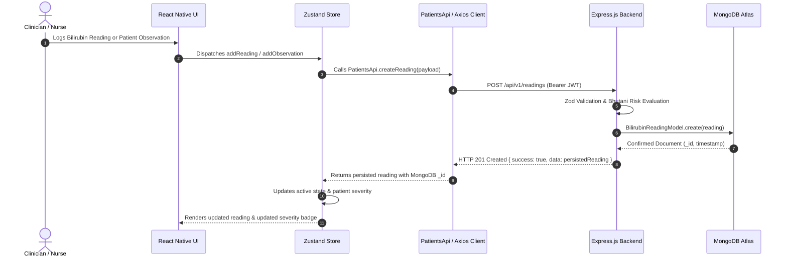

# BiliSURE — Persistence Architecture & Backend Communication

## 1. Overview & Guarantees

BiliSURE employs a clean, minimal persistence architecture where MongoDB Atlas is the sole permanent database and source of truth. The mobile application operates through standard REST communication via the Express.js backend.

1. **Permanent Source of Truth**: All clinical records, babies, bilirubin readings, observations, and station states reside permanently in MongoDB Atlas.
2. **Strict Server-Mediated Access**: The mobile client communicates exclusively with the Express backend via Axios. Database connection strings, credentials, and network secrets are never exposed to the frontend.
3. **Idempotent Writes**: All write operations generate a client operation ID (`clientOperationId`). Re-sending an existing operation ID never creates duplicate medical records.
4. **Clean State Management**: Zustand stores reflect the verified data returned by the backend without relying on local SQLite databases or hardcoded mock fallback data.

---

## 2. Request & Persistence Flow

---

## 3. Data Integrity & Concurrency

- **Bilirubin Readings & Observations**: Additive and append-only. Medical readings are historical observations with strict timestamps and are never destructively overwritten.
- **Patient Profiles (Babies)**: Document updates validate existing records by UHID or MongoDB ObjectId.
- **Empty State Integrity**: When MongoDB collections contain zero records, the backend responds with empty arrays (`[]`) and the frontend displays its designated empty states without injecting mock data.
