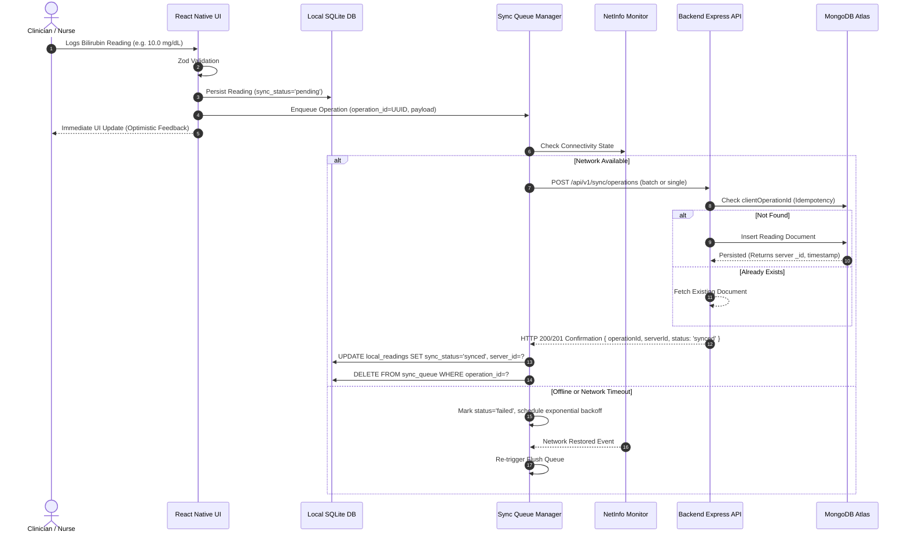

# BiliSURE — Offline-First Synchronization Architecture

## 1. Overview & Guarantees

In healthcare environments, network drops inside NICUs, rural clinics, or maternity wards must never jeopardize patient data. The BiliSURE sync engine enforces the following guarantees:

1. **Zero Data Loss**: Every measurement or profile creation writes to local SQLite before network transmission.
2. **Idempotent Writes**: All write operations generate a client UUID (`clientOperationId`). Re-sending an existing operation ID never creates duplicate medical records.
3. **Resilience to Termination**: Pending sync operations reside in durable SQLite storage, resuming immediately on app startup or network reconnection.
4. **Deterministic Server Mapping**: Server-generated MongoDB `_id`s are reflected back and stored in the local SQLite `server_id` column upon acknowledgment.

---

## 2. Synchronization Flow

---

## 3. Conflict Resolution Strategy

- **Bilirubin Readings & Observations**: Strictly additive and append-only. Medical readings are historical observations at specific timestamps and are never overwritten. If an entry needs correction, a clinical amendment observation is added.
- **Patient Profiles (Babies)**: Last-Write-Wins with server-enforced clinical verification. Demographic changes (e.g. weight update) track `updatedAt`. If server `updatedAt` is greater than client timestamp, server state takes precedence unless client modification was created more recently while offline.
