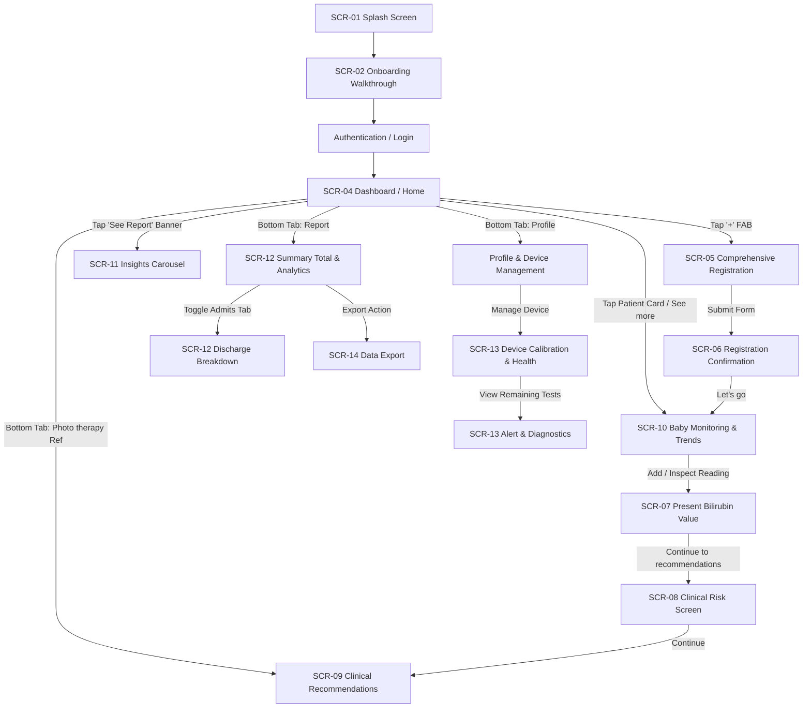

# BiliSURE — Reference Video Analysis & UI Inventory

**Source Video:** `bilisure app.mp4` (Resolution: 720x1600, 29.09 seconds, 554 total frames, 19.04 FPS)  
**Primary Brand Identity:** Deep Purple (`#7C3AED` / `#6D28D9` / `#8B5CF6`) primary accent, clean light backgrounds (`#FFFFFF` / `#F8FAFC`), status colors (Normal Green `#10B981`, Moderate/Warning Amber `#F59E0B`, Critical Red/Coral `#EF4444`), smooth rounded cards (`rounded-2xl` / `rounded-3xl`), modern typography.

---

## 1. Complete Screen Inventory

From frame-by-frame analysis of the video walkthrough, the following 13 distinct screens and state views were identified:

| Screen # | Screen Name | Video Timestamps | Key Visual Elements |
|---|---|---|---|
| **SCR-01** | **Splash Screen** | 0.0s – 1.0s (Frames 0–2), 27.4s – 29.0s (Frames 58–61) | Full-screen vivid purple background, centered bold white "BiliSURE" wordmark with soft magenta/pink radial glow behind "SURE". |
| **SCR-02** | **Onboarding / Walkthrough** | 1.4s – 2.4s (Frames 3–5) | Clean white background, 3D illustrative treatment plan clipboard with purple clip and orange checkmark, Title: *"Planning ahead"*, Subtitle: *"Setup your treatment Plan"*. |
| **SCR-03** | **Register Patient (Basic / Quick Admission)** | 2.8s – 3.8s (Frames 6–8) | Back arrow header, Title: *"Register Patient"*, Rounded border input fields: *Patient's Name*, *UHID*, *Weight*, *Height*, *Assigned Doctor*, *Severity State*, Purple primary button: *"Register"*. |
| **SCR-04** | **Dashboard / Home Screen** | 4.3s – 5.2s (Frames 9–11) | Top left department dropdown (*"Deppt" ▼*), top right notification/filter icon with unread badge (*"1"*), Light purple banner card (*"See Report >"*), Section: *"Today"* with baby cards (UHID pill badge, Baby name, Status in red/green: *Critical* / *Normal*, *"See more"*, right-aligned reading value with time e.g. *10:00 AM*), Section: *"Yesterday"* with historical cards, 5-tab bottom navigation with elevated center FAB (`+`). |
| **SCR-05** | **Comprehensive New Registration** | 5.7s – 6.1s (Frames 12–13) | Coral-red header with back arrow, Title: *"New registration"*, White rounded form card: *Patient's Name*, *Parents' name*, *Date and time of birth*, *UHID*, *Select Facility* (dropdown), *Select Healthcare Provider* (dropdown), *Repeat* toggle (*"Repeat transaction"* switch), Dashed attachment box with paperclip (*"Add attachment"*), Purple primary button: *"Continue"*. |
| **SCR-06** | **Registration Success Confirmation** | 6.6s – 7.6s (Frames 14–16) | Title: *"The Kiddo has been registered!!!"*, Subtitle: *"UHID: M1A2N3S4I5"*, *"Under the supervision of Dr. XYZ"*, Center green circular checkmark icon, Caption: *"You are set!"*, Bottom purple button: *"Let's go"*. |
| **SCR-07** | **Present Bilirubin Value (Reading Detail)** | 8.0s – 9.0s (Frames 17–19) | Purple header sheet with back arrow, Title: *"Present Bilirubin Value"*, Subheading: *"BiliSURE Readings"*, Timestamp: *"12:00 AM DD/MM/YY"*, Large prominent reading display: *"10.0mg/dL"*, Measurement site: *"Site: Palms and soles"*, Bottom white card with *"Other symptoms"* input, expandable *"See history"* accordion, Purple button: *"Continue to recommendations"*. |
| **SCR-08** | **Clinical Risk Assessment** | 9.5s – 10.4s (Frames 20–22) | Solid purple background, Title: *"Risk"*, Large bold text: *"Risk level: Low"* (with status color indicator e.g. light green), *"Reference:"* clinical guidelines section, Bottom white bar with purple button: *"Continue"*. |
| **SCR-09** | **Recommendations Screen** | 10.9s – 12.3s (Frames 23–26) | Solid purple background, Title: *"Recommendations"*, Section 1: *"BiliSURE recommendations"* with white card (*"Suggested: Phototherapy"*, *"Frequency:"*), Section 2: *"Healthcare Provider's recommendations"* with white card (*"Suggested: Phototherapy"*, *"Frequency:"*), Bottom purple button: *"Continue"*. |
| **SCR-10** | **Baby Monitoring & Trends (Patient Detail)** | 12.8s – 14.7s (Frames 27–31) | Top nurse/user avatar, Patient dropdown (*"Baby 1" ▼*), Purple notification bell icon, Status display: *"Present State: Moderate"*, Two colored stat cards side-by-side (Green: *"Initial Value: 10.0g/dL"*, Red: *"Discharge Value: 5.0g/dL"*), Section: *"BiliSURE Bilirubin Readings"* with smooth purple wave spline chart with gradient fill, Time range filter pills (*1hr*, *8hr*, *16hr*, *24hr*), Section: *"Recent Observations"* with *"See All"* button, observation card (*"Baby 1: Face"*, *"Readings By Nurse A"*, reading value *18.0g/dL*, timestamp). Bottom nav bar. |
| **SCR-11** | **Insights / Analytics Story Carousel** | 15.1s – 19.4s (Frames 32–41) | Full-screen multi-slide story carousel with top segmented progress indicators:  • Slide 1 (Coral/Red): *"This Month"*, *"Vacant phototherapy stations: 2"*, card *"Report for increasing Station"*, pill *"Equipment Report: 2"*  • Slide 2 (Emerald Green): *"This Month"*, *"Healthy Kiddos Sent: 500"*, card *"Share The Report"*, pill *"Discharge Discharge: 500"*  • Slide 3 (Purple): *"This Month"*, *"2 of 12 Critical Babies were sent for transfusion"*, pill *"Send Reports"*. |
| **SCR-12** | **Summary Total / Analytics Screen** | 19.8s – 21.7s (Frames 42–46) | Header: Back arrow, Title: *"SUMMARY TOTAL"*, Filter: *"Day" ▼*, View toggle (network chart / donut chart), Multi-segment Donut Chart centered on *"Total Infants"*, Segmented control: *"Total"* vs *"Admits"* (Discharge view), Category filter dropdown & sort icon, Progress bar stats: *In Observation (12)*, *In Phototherapy (8)*, *Critical (4)* / *Discharged (500)*, *Under Treatment (100)*. |
| **SCR-13** | **Device Calibration & Management** | 22.2s – 26.0s (Frames 47–55) | 3 sub-views:  1. *Calibration Settings*: Auto Calibrate switch, Accuracy Test switch, Record Calibration Log switch, 3D sensor grid illustration.  2. *Auto Calibration Status*: Green screen, *"The device is caliberated you are good to go"*, progress bar *"Remaining Test 7500 of 14000"*, *"Share The Report"*.  3. *Test Remaining / Alert Diagnostics*: Alert badge, *"Something seems broken: 10"*, alert box *"Sorry! No more tests can be perfomed"*, *"Contact Support"* button. |
| **SCR-14** | **Data Export Screen** | 26.5s – 26.9s (Frames 56–57) | Header: Back arrow, Title: *"Export Data"*, Form dropdowns: *"What data do your want to export?"* (All / Bilirubin / Patients / Treatments), *"When date range?"* (Last 30 days / 7 days / Custom), *"What format do you want to export?"* (CSV / JSON), Bottom download button: *"Export"*. |

---

## 2. Navigation Architecture & Flow

---

## 3. Detailed UI Design System

- **Colors:**
  - Primary Brand Purple: `#7C3AED` (active tabs, primary buttons, header cards)
  - Purple Light/Tint: `#F3E8FF` / `#EDE9FE`
  - Background: `#FFFFFF` and `#F8FAFC`
  - Text Primary: `#1E1B4B` / `#0F172A`
  - Text Secondary: `#64748B` / `#94A3B8`
  - Normal Status (Green): `#10B981` (pills, donut segment, discharge card)
  - Critical/Alert (Coral/Red): `#EF4444` / `#F87171`
  - Observation/Warning (Amber): `#F59E0B`
- **Typography:** Clean sans-serif (Inter / System font) with heavy bold titles (`font-bold`, `text-2xl` to `text-4xl`), medium section headers (`text-lg font-semibold`), and light subtexts (`text-sm text-gray-500`).
- **Cards & Inputs:** Fully rounded corners (`rounded-2xl` to `rounded-3xl`), subtle soft drop shadows, clean borders (`border border-gray-100`).
- **Buttons:** Full width, `h-14`, rounded-2xl, centered bold white text with purple gradient/solid background.

---

## 4. Unclear or Assumed Requirements & Conservative Architectural Decisions

1. **Authentication:** The video opens directly after splash into onboarding and the main flow. An authentication module (Login/Register/Session management with JWT) is added as mandated by Section 6 Module 1, fitting seamlessly between Onboarding and Dashboard.
2. **Device Hardware Scope:** Per strict scope instructions, the physical BLE device SDK is NOT connected in this phase. The Device Management and Calibration screens (SCR-13) are implemented using an abstracted `DeviceService` with local/server profiles and realistic calibration/accuracy diagnostic routines, ready for Kotlin/BLE integration later.
3. **Clinical Recommendation Logic:** Recommendations shown in the video display Phototherapy and provider instructions. In accordance with Section 6 Module 7, clinical algorithms are isolated in a clinical rules service and automated suggestions are clearly designated with medical guideline references (AAP / NICE guidelines) and pending provider confirmation.
4. **Offline Persistence & Sync:** Every reading, observation, and baby registration created locally is saved immediately to SQLite before syncing to MongoDB when online, strictly fulfilling the offline-first requirement.
